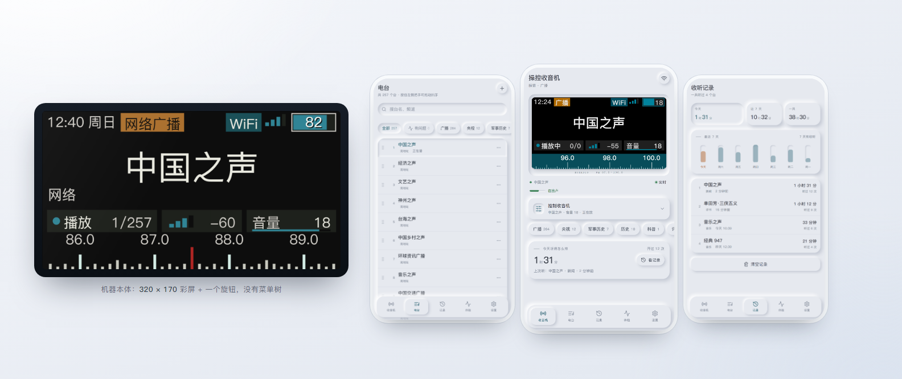
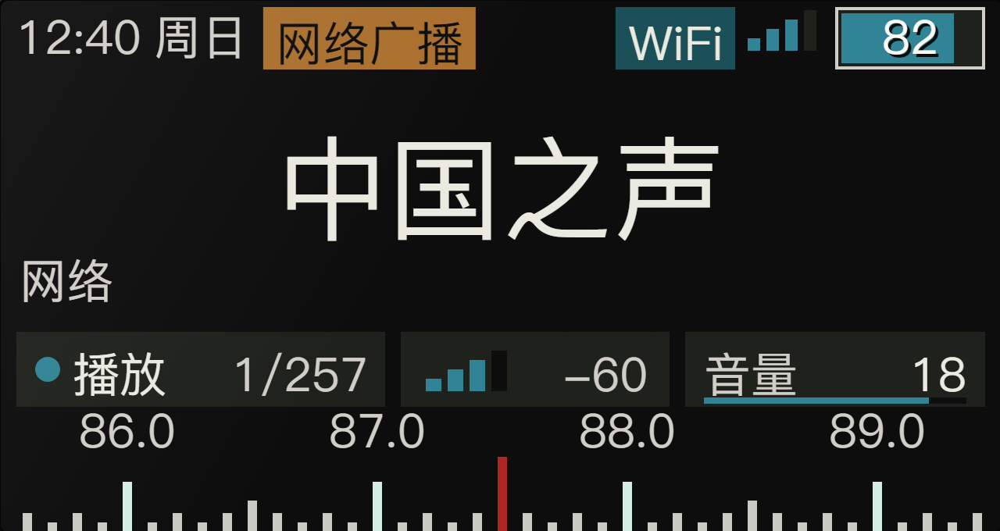
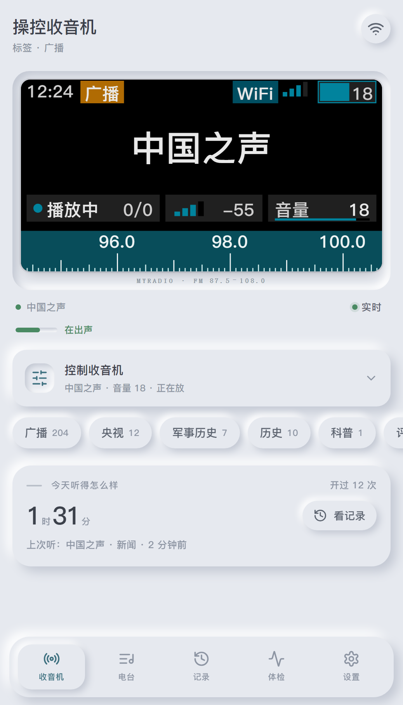
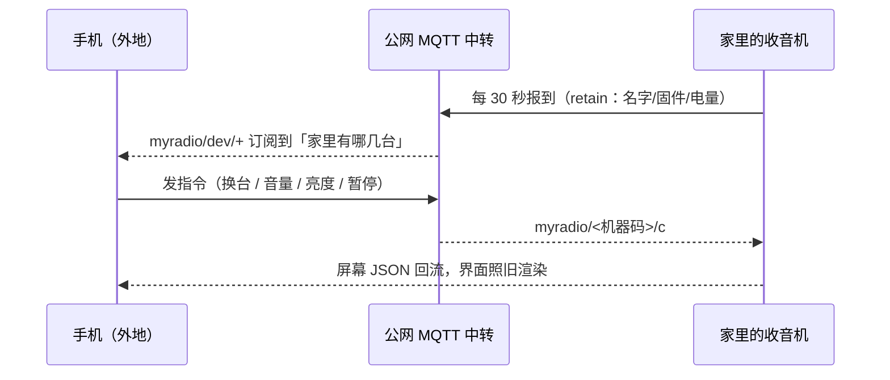
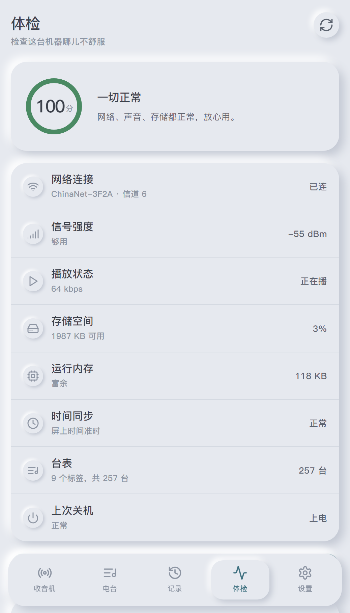
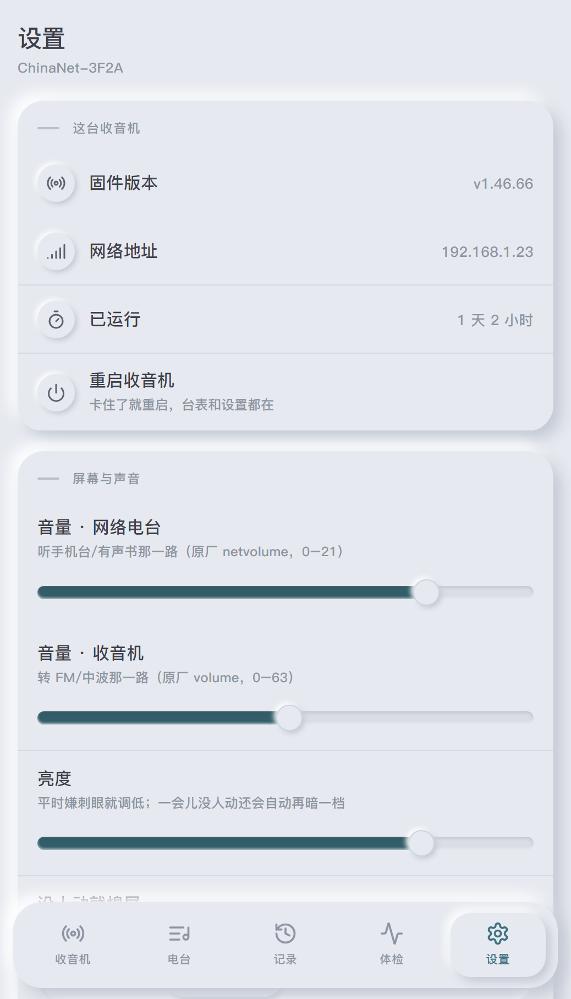
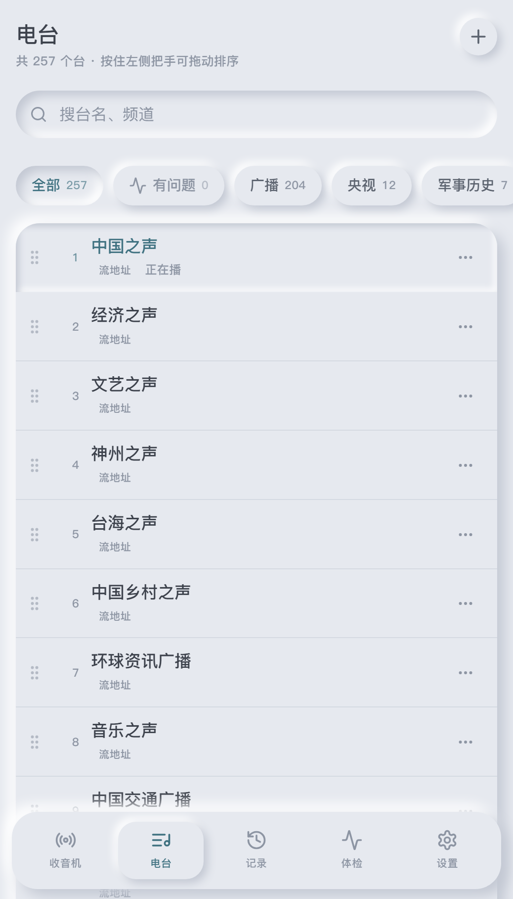
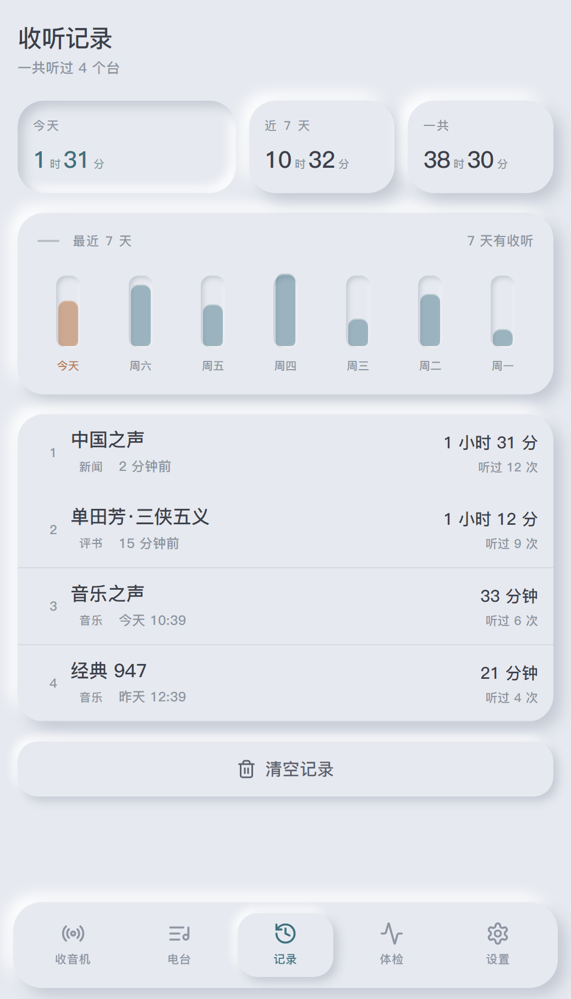
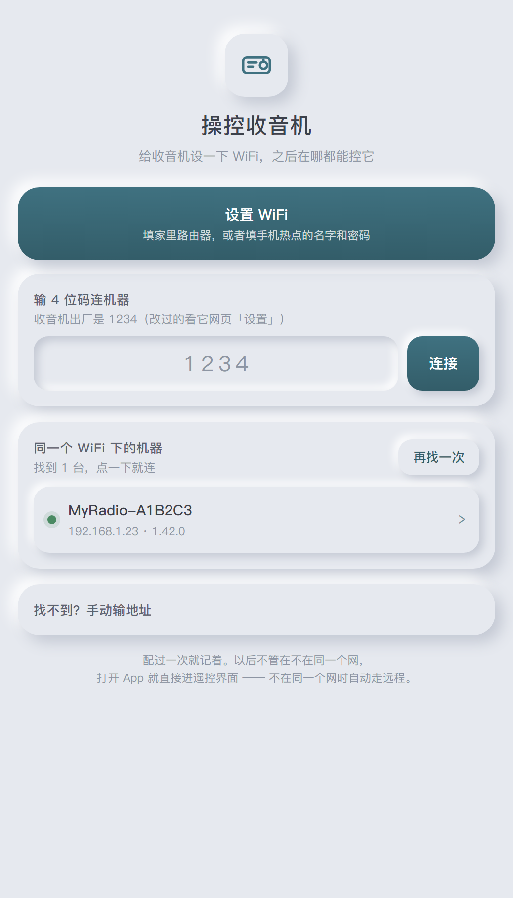

# MyRadio · 只有一个旋钮的网络收音机

**上电就出声。会转旋钮就能用。**
有网放网络台，没网自己切 FM 收音，网回来了自己切回去 —— 不用管，不用按。

<p>
  
  
  
  
</p>



> 这是给家里长辈做的一台收音机：**一块 320×170 的屏、一个旋钮、三个操作源**（旋钮 / 遥控器 / 手机）。
> 屏上永远只有「现在放的是什么」，所有设置都在手机里 —— 机器上没有一个菜单项。

---

## 目录

| 章节 | 内容 |
|---|---|
| [1. 它是什么](#1-它是什么) | 三块东西：机器、固件、手机 App |
| [2. 屏幕长什么样](#2-屏幕长什么样) | 一块屏上分了哪五个区 |
| [3. 设计亮点](#3-设计亮点) | 九条设计取舍，每条都说清「为什么」 |
| [4. 怎么操作](#4-怎么操作) | 旋钮 6 个手势 / 遥控器 7 个键 / 手机 5 个页签 |
| [5. 手机 App：源码与安装包](#5-手机-app源码与安装包) | `android/` 工程 + 各版本 APK |
| [6. 编译与烧录](#6-编译与烧录) | 从源码出固件、出 APK |
| [7. 源码结构](#7-源码结构) | 每个文件是干什么的 |
| [8. 台表与内容](#8-台表与内容) | 257 个台、41 部有声书、9 个标签 |
| [9. 文档索引](#9-文档索引) | 说明书 / 开发文档 / 改动记录 |
| [10. 已知限制](#10-已知限制) | 别指望它做什么 |

---

## 1. 它是什么

这是一套**完整可复刻**的软硬件：一台基于 ESP32-S3 的网络收音机，加一个只做「外壳」的安卓 App。

| | 是什么 | 在哪 |
|---|---|---|
| **机器** | ESP32-S3 + 320×170 彩屏 + 单旋钮 + SI4732 收音芯片 + 600mAh 小软包电池 | `src/`（固件） |
| **手机 App 界面** | 一个网页，**由收音机自己发出来**（`http://<机器IP>/`），烧在固件的 `src/webapp.h` 里 | `src/webapp.h` |
| **手机 App 外壳** | 安卓工程：配网、找机器、把 WebView 指过去、外地走远程页 | [`android/`](android/) |
| **安装包** | 预编译 APK，1.19.2 → 1.26.6 全在仓库根目录 | `MyRadio-*.apk` |

**为什么界面放在固件里、不放进 APK？**
界面里 60 多处请求全是 `/api/...` 的相对路径，只有「页面也是这台机器发的」时才同源。
塞进 APK 就要重写全部请求前缀、处理 CORS、还要给 `/api/screen` 那条流做代理 —— 风险远大于收益。
放固件里的好处是：**固件升级，界面自动跟着新**，APK 一个版本能用很久。

---

## 2. 屏幕长什么样



屏幕 320×170 只分五块，从上到下就是一个人听收音机的全部信息：

| 位置 | 显示什么 | 说明 |
|---|---|---|
| 左上 | `12:34 周日` | 上游同步来的时间，断网也走 RTC |
| 中上 | `网络广播` / `调频` / `中波`… | 琥珀色块 = 当前模式；WiFi 图标跟信号格在右边，电量在最右 |
| 正中 | **中国之声**（大字） | 只有台名。转旋钮时变灰 = 还在挑，松手才切 |
| 中下 | `播放 1/257`、信号条 `-54`、`音量 18` | 三个方框：状态 / 信号 / 音量，按住旋钮转时中下变大字「音量 45」 |
| 底部 | 调谐盘 `86.0 … 89.0` | 游标落在哪就是当前频率；网络台也显示它在盘上的位置，切到 FM 时是同一套坐标 |

> 这张图是 `preview/index.html` 里按 `ui.cpp` 坐标**逐像素重绘**的预览，不是拍屏 —— 所以文字绝对清晰。
> 想看会动的：直接打开 `preview/index.html`，左边能转旋钮、右边能加台。

---

## 3. 设计亮点

### 3.1 没有菜单树：一个旋钮，六种手势

老人用不了「设置 → 系统 → 网络」这种路径。所以机器上**只有旋钮一个控件**，把六种手势排满它：

| 手势 | 作用 | 为什么这么定 |
|---|---|---|
| 旋转 | 换节目（一格一个台／一部书） | 停手 0.25 秒才真切台 —— 快速转过时不会听到一串杂音 |
| 点一下 | **什么都不做**，只点亮屏幕 | 1.6~1.14 版它是「换分组」，实测长辈一碰就跳台，干脆取消 |
| 按住 + 旋转 | 调音量（±2/格） | 遥控器丢了也能调；转的时候屏中间那行字会变成「音量 45」 |
| 双击 | 回到第一个台 | 听乱了不用一路转回去 |
| 长按 0.7 秒 | 重连当前台 | **最常用的一招**：没声音先长按，多半就好 |
| 长按 3 秒 | 开关机器 WiFi 热点 | 默认关；换手机、换路由器时才用得上 |

### 3.2 断网不是故障：网络台 ⇄ FM 自动降级

```mermaid
flowchart LR
  A([开机]) --> B{连上 WiFi?}
  B -- 是 --> C[放网络台<br/>257 台 / 41 部书]
  B -- 否 --> D[SI4732 收音<br/>FM 64–108MHz<br/>+ 中波/长波/短波]
  C -- 断网 20 秒 --> D
  D -- 网络恢复 --> C
  C -. 长按旋钮 0.7s .-> C
  D -. 旋钮变调频 .-> D
```

- 判据是**连续断网 20 秒**（不是一次丢包），切换时屏上模式块会从「网络广播」变成「调频」，游标不动 —— 听起来像是同一台机器换了个源。
- 切回来时**位置不丢**：网络台还是原来那个台。
- 进收音模式后，旋钮从「换台」变成「调频率」，长波/中波/调频/短波连成一个圈；1.46.59 起开机不再自动搜台，停在**上次听的频率**。

### 3.3 手机不是遥控器，是**屏幕的实时镜像**



主页最上面那块黑屏是**真机屏幕的镜像**：App 每 900ms 取一次 `/api/screen` 的 JSON，
按 `ui.cpp` 的坐标用 Canvas 重画一遍 —— 不是截图，所以流量只有几 KB、文字永远清晰。

这解决了一个很实际的问题：**人在外地，电话里问「现在屏上写什么」，老人念不出来。**
现在子女手机上看到的就是一模一样的一屏。

下面「控制收音机」折叠面板里有换台、音量、暂停；再下面「今天听得怎么样」是当日收听时长。

### 3.4 电量必须说实话（小软包电池的坑）

600mAh 的 602535 小软包内阻大，**插着电、放着歌、拔掉电，同一个电池能读出三个数**。
早期的做法是「电压对表」，于是出现了用户最抓狂的现象：

> 没电关机 → 开机插电显示 77% → 拔电一会儿变成 3%

现在的做法：

1. **开路电压（OCV）才作数**。每 4 分钟静音 180ms 量一次真开路电压，平时用「学到了的负载压降」反推；
2. **插拔靠相对台阶识别**，不看绝对电压（小软包 CC 段根本到不了 4.05V，老代码那条分支从没执行过）；
3. **充电期间按时间爬**（1% / 48 秒），CV 平台稳住 45 分钟才判满；
4. **留 10~15% 余量**：关机线定在开路 3550mV（表值约 9~10%），屏上永远不会出现 3% 然后黑屏。

> 这一条是**真机调出来的**，不是仿真调出来的：把 1.46.65 刷进去逐字段核对，才发现压降的符号写反、
> 以及 FM 模式下 `audioIsPlaying()` 恒为 false（功放明明在响，却当成空载）。
> 完整排查记录在 [CHANGELOG.md](CHANGELOG.md) 的 1.46.66 条目里。

### 3.5 它会说话

两句中文**预先合成进固件**（142KB rodata），断网也能念：

- 电量低于 15% → 「电量低，请充电」
- 开路电压掉到 3550mV 并持续 90 秒 → 「没电了，关机」，然后断 IO15 自锁

### 3.6 不在家也能管它（不开端口、不要公网 IP）



机器**主动往外连**，所以家里不用端口映射、不需要公网 IP。
遥控码由设备码算出（FNV-1a），不用手抄；机器开着配对码保护时，要先在屏上看到 6 位数字。

### 3.7 出问题先「体检」，不猜



8 项逐个打分（网络 / 信号 / 播放 / 存储 / 内存 / 时钟 / 台表 / 上次关机），
分数低于 80 才在底部页签上点红点。发现问题点**「一键修复」**，它按依赖顺序自己排动作：
重开这一个台 → 重连 WiFi → 清记录 → 重启 → 恢复出厂，只做该做的那一步。

另外每台还有一份**健康档案**：某个台连着几次连不上，列表里那一行会自己标出「连不上 N 次」，
点开能看它最近失败的时间线 —— 而不是让老人反复试。

### 3.8 界面语言：新拟物（一只底色，全靠光与影）



- **全站只有一个底色**，卡片、按钮、滑槽都和底同色 —— 没有边框、没有分隔色块；
- 靠一对双向阴影塑形：左上白光 + 右下暗影 = **凸起，可以点**；两个 inset = **凹陷，可以输入 / 拖**；
- 圆角只走大弧：卡片 24、按钮 18、药丸 999、弹层 28（出现直角就退回「线框卡片」）；
- 颜色近乎单色，主色只是一层薄雾青，**只出现在「正在播 / 选中 / 主行动」**；
- 数字全部 `tabular-nums`，电量从 9% 跳到 10% 时宽度不会抖。

### 3.9 为「手抖的长辈」做的容错

| 现象 | 处理 |
|---|---|
| 连点两下旋钮 | **不静音**（1.38.0 起）—— 误触把声音弄没了比误触换台更糟 |
| 快速连转 20 格 | 只连最后一个台，中间不发声 |
| 拔插电源瞬间电压跳变 | 冻住显示 90 秒，等表面电荷散掉再采信 |
| 噪声导致瞬时低电 | 要连续 20 秒才念「电量低」 |
| 开机 5 分钟内 | 绝不自动关机（防止刚开机就误判没电） |
| App 连不上机器 | 不拦路：顶上挂一条「点这里换 WiFi」，人还能进设置页 |

---

## 4. 怎么操作

### 4.1 旋钮

见 [3.1](#31-没有菜单树一个旋钮六种手势) 的六种手势。补两条细节：

- **有声书一格就是一部书**，不是一集；进书之后在 App 里选集。
- **调频模式下**长波/中波/调频/短波连成一个圈，转一格 1 个台（FM 是 0.1MHz），转快了自动加速。

### 4.2 遥控器（7 个键，可学习）

| 按键 | 作用 |
|---|---|
| CH+ / CH− | 上一台 / 下一台（和转旋钮一样） |
| 音量 + / − | 音量，每次 ±5 |
| 播放 / 暂停 | 暂停、继续 |
| ◀ / ▶ | 无功能（1.15.0 起没有分组了），键位留着，老遥控器不用重学 |

**换一个遥控器也能用**：断电 → 按住旋钮通电 → 屏上出现 `按 下一台 (1/7)` → 按顺序按 7 个键 → 自动存进 flash。
不学也行：固件内置常见 NEC 默认码，拿个电视遥控器按一下大概率直接能响。

### 4.3 手机 App：五个页签

<table>
<tr>
<td width="25%"></td>
<td width="25%"></td>
<td width="25%"></td>
<td width="25%"></td>
</tr>
<tr>
<td><b>① 收音机</b><br>屏幕镜像 + 控制面板 + 今日收听</td>
<td><b>② 电台</b><br>257 台一张表，按住左侧把手拖动排序</td>
<td><b>③ 记录</b><br>今天/近 7 天/一共，点一行「再听一次」</td>
<td><b>④ 设置</b><br>版本、网络、两路音量、亮度、配对码</td>
</tr>
</table>

**② 电台**这一页是子女用得最多的：加台（粘贴流地址）、删台、改名、拖拽排序、
换标签、按标签筛。删掉「正在播的那个台」，它会自己接着放下一台。

**③ 记录**：机器自己记账，不是 App 记的 —— 换手机也在。每行显示「听过多久 / 多少次 / 上次什么时候」。

**⑤ 体检**（第四个页签）见 [3.7](#37-出问题先体检不猜)。

### 4.4 配网（给机器换 WiFi）



1. 点「设置 WiFi」→ 出现在线表单，**自动预填手机当前连的 SSID**，只要补密码；
2. 也可以点「从手机附近选一个」，列表是**手机扫的**（按信号排序、带 dBm），机器不参与扫描；
3. 发过去之后机器是「新网络 + 旧网络」一起提交的 —— 连不上会自己退回原网络，**不会失联**；
4. 热点是备选不是首选：机器没网时按住旋钮 3 秒开热点（`我的收音机`，无密码），手机连上去填表。

---

## 5. 手机 App：源码与安装包

### 5.1 源码

安卓工程在 [`android/`](android/)，**只做外壳**（界面本体在固件的 `src/webapp.h`）：

```
android/
├── build.gradle / settings.gradle / gradle.properties
├── myradio.keystore                自签证书（alias myradio）
└── app/
    ├── build.gradle                com.myradio.app · minSdk 23 · targetSdk 34
    └── src/main/
        ├── AndroidManifest.xml
        ├── java/com/myradio/app/
        │   ├── MainActivity.java   WebView + 跳转 + 返回键 + JS 桥（MRApp）
        │   ├── Discovery.java      mDNS + /24 端口扫描（两条腿找机器）
        │   ├── Provision.java      配网：探测 → 发 WiFi → 等新 IP
        │   └── PairFind.java       配对码查找
        ├── assets/
        │   ├── home.html           首页：设置 WiFi / 找机器 / 手动地址
        │   └── remote.html         远程页（外地控制，MQTT）
        └── res/                    图标 / 主题 / network_security_config
```

几点值得知道的：

- **找机器有两条腿**：先 mDNS（秒级），再 `/24` 全网段并发探 80 端口（约 3 秒），
  探通还要 `GET /api/info` 认人 —— 免得把路由器管理页当机器。
- **进机器页有看门狗**：先进子线程 `connect(ip, 80, 900ms)`，连不上直接走退路（远程页 → 配网页），
  绝不把人扔在 WebView 自带的「网页无法打开」上。
- `192.168.4.1` **永远不算「这台机器的 IP」**：它只在机器热点开着时通，一回家用 WiFi 就关。

### 5.2 安装包（APK）

仓库根目录带了**每个历史版本**的包，直接下载装上就能用（同一个签名，可覆盖升级）：

| 版本 | 文件 | 说明 |
|---|---|---|
| **1.26.6** | [`MyRadio-1.26.6.apk`](MyRadio-1.26.6.apk) | 最新：进机器页的超时/退路修好 |
| 1.26.5 | [`MyRadio-1.26.5.apk`](MyRadio-1.26.5.apk) | — |
| 1.26.3 / 1.26.2 / 1.26.1 / 1.26.0 | `MyRadio-1.26.*.apk` | 远程页、配对码、稳定性 |
| 1.25.0 / 1.24.0 / 1.23.0 | `MyRadio-1.2*.apk` | 界面改版（新拟物） |
| 1.22.0 / 1.21.0 / 1.20.0 | `MyRadio-1.2*.apk` | 台表调整、央视频道 |
| 1.19.3 / 1.19.2 | `MyRadio-1.19.*.apk` | 最早的公开版本 |

**装法**：拷到手机 → 点击安装 → 允许「安装未知来源应用」。
装完打开，第一次会让你填 WiFi 或直接连机器 —— 之后就记住地址了。

> 签名是自签的（`android/myradio.keystore`），所以只能本仓库的包互相覆盖升级；
> 想自己出包，用 `python tools/build_apk.py`，见下一节。

---

## 6. 编译与烧录

### 6.1 固件（PlatformIO）

```bash
pip install platformio
pio run                       # 编译
pio run -t upload             # 烧录（USB）
pio device monitor            # 看串口日志
```

产物在 `.pio/build/esp32-s3-devkitc-1/firmware.bin`。
`firmware/` 目录里放了三个现成的 bin：

| 文件 | 烧到哪 | 什么时候用 |
|---|---|---|
| `固件-只刷APP-0x10000.bin` | **0x10000** | 日常升级，只覆盖 APP 分区（最常见） |
| `固件-整片烧写-0x0.bin` | 0x0 | 换芯片 / 分区表变了 / 救砖 |
| `bootloader.bin` + `partitions.bin` | 0x0 / 0x8000 | 手动整片烧写的分件 |

### 6.2 手机 App（APK）

```bash
python tools/build_apk.py            # 出包 → 根目录 MyRadio-<versionName>.apk
python tools/build_apk.py --icon     # 顺带重画桌面图标
```

本机工具链（JDK 17 / SDK 34 / Gradle 8.6 / AGP 8.4）路径都写在脚本里，
全量 `clean assembleRelease` 约 20~30 秒，不需要联网。

### 6.3 生成 README 里的截图

```bash
python tools/gen_readme_shots.py     # → docs/img/*.png
```

截的是**真界面的那一份代码**：App 截图从 `src/webapp.h` 抠 HTML 再注入假数据，
机器屏从 `preview/index.html` 按 canvas 的实际坐标裁，所以文档永远跟代码一致。

---

## 7. 源码结构

```
src/
├── main.cpp / main.h        入口、开机流程、主循环
├── config.h                 所有引脚、阈值、版本号（改参数先看这里）
├── ui.cpp / ui.h            320×170 屏的全部绘制（App 的镜像按它的坐标重画）
├── input.cpp / input.h      旋钮六种手势、遥控器解码、红外学习
├── audio.cpp / audio.h      网络流播放（基于 lib/ESP32-audioI2S）
├── fm.cpp / fm.h            SI4732：调频/中波/长波/短波、搜台、静噪
├── net.cpp / net.h          WiFi、配网、REST API（51 个接口）、mDNS
├── cloud.cpp / cloud.h      公网 MQTT 中转（异地控制）
├── battery.cpp / .h         电量估算：OCV + 压降学习 + 插拔状态机
├── power.cpp / power.h      亮度、省电、关机、充电控制
├── store.cpp / store.h      台表 / 标签 / 设置落盘（LittleFS + NVS）
├── history.cpp / .h         收听记账（今日 / 近 7 天 / 累计）
├── health.cpp / health.h    每台的健康档案（连不上/没声音 的时间线）
├── epis.cpp / album.cpp     有声书与分集
├── resume.cpp / m4aseek.cpp 断点续听、m4a 拖动
├── voice.cpp / voice_data.h 两句中文放音（预合成进 rodata）
├── webapp.h                 **手机 App 的界面本体**（HTML/CSS/JS，约 190KB）
└── preset_stations.h        257 台台表（由 tools/ 生成，别手改）
```

**REST 接口**（51 个，全部 `/api/*`）按用途分组：

| 组 | 接口 |
|---|---|
| 状态 | `screen` `state` `info` `batt` `diag` `health` `log` `offair` |
| 播放 | `play` `pause` `vol` `mute` `step` `epis` `epnext` |
| 台表 | `stations` `add` `del` `edit` `move` `group` `groupop` `mvgroup` |
| 收音 | `fmtune` `fmscan` `fmstations` `fmprobe` `halfstep` `squelch` |
| 网络 | `wifi` `wifi/list` `wifi/add` `wifi/use` `wifi/forget` `wifi/status` `scan` `cloud` |
| 安全 | `auth` `pair`（可选 6 位配对码） |
| 维护 | `fix` `set` `enc` `gpio` `pins` `tone` `sweep` `battcal` |

---

## 8. 台表与内容

| | 数量 | 来源 |
|---|---|---|
| 网络电台 | 257 个 | 央广 / 各省市台 / 央视音频，人工精选（去音乐台、广告台、非汉语台） |
| 有声书 | 41 部 | 喜马拉雅 / 听书网 / 云听 / 蜻蜓，均匀穿插在电台之间（约每 6 台一本） |
| 标签 | 9 个 | 广播 / 央视 / 军事历史 / 历史 / 科普 / 评书 / 广播剧 / 悬疑 / 都市 |

- 机器上**不再分组**：所有台串成一个列表，旋钮从第 1 台一路转到底；
- 标签只留在 App 里做筛选和管理，不影响播放顺序；
- 台表是生成出来的：改 `tools/台表-精选.md`（一行一个台）或 `tools/有声书源*.json`，
  再跑 `python tools/gen_preset_curated.py`。

---

## 9. 文档索引

| 文档 | 给谁看 |
|---|---|
| [`说明书.md`](说明书.md) / [`说明书.html`](说明书.html) | **给用的人**：一分钟上手、每个手势、出问题怎么办 |
| [`开发文档.md`](开发文档.md) | **给改代码的人**：架构取舍、接口细节、跨网协议、已知限制（原 README，很长很细） |
| [`CHANGELOG.md`](CHANGELOG.md) | 每次改了什么、为什么改、动了哪些文件（含真机实测数据） |
| [`android/README.md`](android/README.md) | App 外壳的设计取舍与踩过的坑 |
| [`原厂对照报告.md`](原厂对照报告.md) | 与原厂固件的逐项对比 |

---

## 10. 已知限制

- **FM 灵敏度受硬件限制**：这个模块靠耳机线当天线，而这台机器的耳机口接的是功放 LINE IN。
  实测室内最高 `rssi≈36 / snr≈2`，所以**一律单声道**（弱信号下比硬解立体声更响、更干净）。
  固件补不了这一条 —— 想改善就在 `ANT` 焊盘接 30~50cm 导线。
- **App 必须先摸到机器才能出界面**：界面是机器发的。人在外网时自动走内置远程页（MQTT）。
- **异地控制依赖公共 MQTT 中转**，中转挂了就只剩局域网可用。
- **没有语音助手、没有蓝牙、没有 SD 卡**：这是有意不做，不是没做完。
- `lib/ESP32-audioI2S` 是 vendored 的第三方库（打了两个补丁，见 CHANGELOG），遵循其自带许可。

---

<p align="center">
  <sub>为「只会转旋钮的人」而做 · 固件 1.46.66 · App 1.26.6</sub>
</p>
